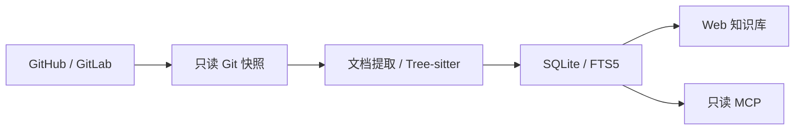

# RepoKnow · 知仓

A self-hosted, model-free knowledge base for GitHub and GitLab repositories.

[](https://github.com/gdpu11/repoknow/actions/workflows/ci.yml)

[源码](https://github.com/gdpu11/repoknow) · [反馈问题](https://github.com/gdpu11/repoknow/issues) · [MCP 接入](docs/MCP.md)

把 Git 仓库变成可检索、可追溯的知识库。通过浏览器或 MCP 搜索文档、阅读代码、查询符号和直接调用线索。**CPU 即可运行，无模型、无向量服务、无需 GPU 或 AI API Key。**

基于 Git 固定快照、Tree-sitter 和 SQLite FTS5，采用 [MIT 许可](LICENSE)。当前为 `0.2.0` 早期版本。

## 功能

- **仓库导入**：支持公开和有权限访问的私有 GitHub、GitLab、自建 GitLab 仓库，使用 HTTP(S) 克隆地址。
- **批量导入**：分页发现 GitLab 组 / 子组、GitHub 组织（含 Enterprise）的可见仓库，逐仓库索引；已有分支跳过，无默认分支等情况说明原因。
- **成员准入**：默认关闭公开注册；管理员创建、启用或停用普通成员，停用会撤销该成员的登录会话和只读 Key。
- **凭证复用**：Token 按登录账号和平台域名加密保存，同域名仓库自动复用。
- **文档与源码**：Markdown、源码行号、模块目录、路径筛选和固定 commit 的来源链接。
- **符号与调用线索**：解析 Python、Go、JavaScript、TypeScript / TSX、Java；其他支持的文本格式仍可全文检索。
- **跨仓库检索**：搜索文档、代码和符号，返回 commit、文件路径、行号和原仓库链接。
- **只读 MCP**：AI 客户端可查询知识库，服务端不调用模型。
- **同步与隔离**：同 commit 复用索引，新索引事务发布，失败保留旧版本；私有知识库仅所有者可读。



## 快速开始

需要 Linux 或 macOS、Python 3.10+、Git 和 [uv](https://docs.astral.sh/uv/)。Windows 可使用 Linux 容器或 WSL，本机进程管理依赖 POSIX。

克隆并启动：

```bash
git clone https://github.com/gdpu11/repoknow.git
cd repoknow
uv sync --locked
python3 scripts/manage.py start
```

打开 **[http://localhost:8090](http://localhost:8090)**。首次启动随机生成管理员密码和只读 MCP Key，保存在 `.data/admin.json`，文件权限为 `600`。使用其中的 `username`、`password` 登录。

每次新安装都有自己的随机凭证；源码不携带预置密码、已导入仓库或预登录会话。

```bash
python3 scripts/manage.py status
python3 scripts/manage.py stop
```

停止服务会保留索引和凭证。可选导入两个公开示例：

```bash
.venv/bin/python scripts/demo.py
```

示例来自 [go-chi/chi](https://github.com/go-chi/chi) 和 [GitLab Python 示例](https://gitlab.com/gitlab-examples/python-getting-started)。只读取仓库，不执行其代码或安装其依赖。

## 账号与升级

默认关闭公开注册。管理员登录后，打开侧栏 **团队成员** 创建普通账户或停用 / 启用成员。停用立即撤销其登录会话和只读 Key；重新启用后需要重新登录，原 Key 不会恢复。仓库、索引和凭证保留，共享知识库仍按原可见性开放。管理员账号不能停用。

如确需公开自助注册，在启动进程环境中设置 `REPOKNOW_ALLOW_REGISTRATION=1`（Docker 在 `compose.yaml` 的 `environment` 中设置），然后重启；自助注册始终创建普通成员。

从 0.1.x 升级前，停止进程并备份整个数据目录；更新源码、执行 `uv sync --locked` 后重新启动。首次迁移将原启动时创建的首个账号设为管理员，其他账号保留为普通成员；原密码、MCP Key、平台凭证和索引保留。升级后公开注册默认关闭。不要删除或重新生成 `admin.json`、`credentials.key` 或数据库。

## Docker

需要 Docker Engine 和 Docker Compose v2。也可以直接用 Docker CLI 构建和运行镜像。

```bash
docker compose up -d --build
docker compose exec repoknow cat /data/admin.json
```

默认仅绑定 `127.0.0.1:8090`，使用独立的 `repoknow-data` 命名卷。不要和本机进程同时占用同一端口，也不要让两个实例访问同一数据库目录。

## 导入私有仓库、GitLab 组和 GitHub 组织

1. 打开侧栏 **平台凭证**，填 Git 平台域名，例如 `https://gitlab.example.com`、Git 账号和只读 Token。
2. 选择 **导入仓库 / 组 / 组织**，填写地址；默认复用同域名的平台凭证。
3. 等待后台索引完成，进入知识库浏览或检索。

GitLab 权限：单仓库克隆使用 `read_repository`；组发现加克隆使用 `read_api` 和 `read_repository`。Token 需要有目标组/仓库的访问权限，参见 [GitLab 官方权限说明](https://docs.gitlab.com/security/tokens/access_token_scopes/)。Deploy Token 仅用于单仓库克隆，不用于组 API 发现。

GitHub 建议使用限定目标组织和仓库的 Fine-grained PAT，赋予 Metadata 读取和 Contents 读取权限；组织策略可能要求管理员批准或 SSO 授权。公开组织可匿名预览，受 GitHub API 限流影响。参见 [组织仓库 API 与权限](https://docs.github.com/en/rest/repos/repos#list-organization-repositories)。GitHub Enterprise 在平台凭证中选择 GitHub，使用该实例的 Token，组织发现通过同域名 `/api/v3` API。

| 类型 | 地址示例 |
|---|---|
| 仓库 | `https://gitlab.example.com/engineering/api.git` |
| 组 | `https://gitlab.example.com/engineering` |
| 子组 | `https://gitlab.example.com/engineering/backend` |
| GitHub 组织 | `https://github.com/example-org` |
| GitHub Enterprise 组织 | `https://github.example.com/engineering` |

- 分支留空时检测默认分支。组导入默认包含子组，排除其他组共享进来的项目。
- 完整发现成功后才写入任务，发现失败不留下部分导入；每个仓库独立索引，一个失败不影响其他任务。
- 重复导入只补充新仓库，不覆盖已有配置或刷新已有索引；已有仓库通过 **同步更新** 刷新。
- 平台凭证更新后，引用它的仓库在下次同步时使用新 Token；更新时留空保留原值，界面不回显旧值。
- 也可展开 **仅为此仓库填写凭证**。仓库页的 **更新凭证** 仅作用于该仓库，并取消其平台凭证引用。

组和组织不包括个人用户主页。界面可先“仅查看发现结果”，确认后再导入；当前不定时发现新增仓库，需再次发起批量导入。

## 通过命令或 AI 代理导入

先在界面配置平台凭证，再使用本地管理命令：

```bash
.venv/bin/python scripts/import_source.py https://gitlab.example.com/engineering/api.git --wait
.venv/bin/python scripts/import_source.py https://gitlab.example.com/engineering --kind group --wait
.venv/bin/python scripts/import_source.py https://github.com/example-org --kind organization --wait
```

命令使用 `.data/admin.json` 登录本机管理 API，默认按域名复用凭证，不接受 Token 命令行参数。`--connection` 可指定已有凭证名称或 ID；`--branch` 指定单仓库分支；`--no-subgroups` 关闭递归子组。

默认返回创建结果；`--wait` 等待索引并报告逐仓库结果，默认 600 秒，`--timeout` 可调整。等待超时不取消后台任务。多级子组和仓库无法只凭 URL 区分，组导入请明确使用 `--kind group`。`github.com` 单层主页默认识别为组织；GitHub Enterprise 组织请使用 `--kind organization`。

代理可在用户授权后执行此命令，实现“导入这个仓库 / 这个组 / 这个组织”的对话操作；RepoKnow 本身不内置语言模型。

## MCP 接入

端点：`http://127.0.0.1:8090/mcp`，使用 Streamable HTTP 的 JSON 响应模式。客户端发送：

```text
Authorization: Bearer <read_only_api_key>
```

Key 取自自己实例的 `.data/admin.json`，用于访问知识库，与后台拉代码的 GitLab / GitHub Token 分开；不要将真实值提交到版本控制。

| 工具 | 用途 |
|---|---|
| `knowledge_catalog` | 当前账号可见的仓库、索引状态和版本 |
| `knowledge_search` | 跨仓库或限定仓库搜索文档、源码、符号 |
| `knowledge_get_source` | 按完整 commit、路径读取最多 200 行 / 32 KiB |
| `knowledge_get_symbols` | 查询函数、方法、类等定义 |
| `knowledge_trace_dependency` | 查询符号的直接调用方、被调用方和来源 |

MCP 不提供导入、同步、Token 管理或代码修改。管理操作使用界面或登录认证的管理 API。源码查询严格校验 commit，版本不匹配会报错，不替换成新版本的同一行。

Codex 配置示例见 [MCP 接入说明](docs/MCP.md)。源码包只提供占位配置，不会自动修改客户端的全局配置。

## 数据、安全与限制

- 数据默认在 `.data/`，数据库为 `repoknow.sqlite3`；`REPOKNOW_DATA_DIR` 可指定其他位置，`REPOKNOW_PORT` 可调整本机管理脚本端口。
- 导入和示例命令默认连接 `http://127.0.0.1:8090`；调整端口后，用 `REPOKNOW_URL` 指定对应的本机地址。
- Token 使用 AES-256-GCM 加密并绑定仓库/平台凭证 ID，密钥在 `credentials.key`。备份数据库时必须同时备份密钥；Git 缓存一并保存便于恢复。备份仍应按私有资料保护。
- Git 只读抓取到 bare 缓存，不 checkout、不执行仓库代码、依赖安装、构建、Git hook 或子模块递归。
- 批量发现 API 和管理命令不跟随重定向；平台凭证仅用于相同协议和域名。HTTPS 校验保持开启，内部 CA 需要正确安装到信任环境。
- `.env*`、常见私钥、生成产物、二进制和明显密钥模式会过滤，但过滤不等于完整 DLP。被授权索引的业务资料仍会保存在本机数据库中。
- 默认单文件 512 KiB、单仓库 2 万合格文件 / 64 MiB 文本、单次组 / 组织发现 5000 仓库；超过总预算会明确失败，不静默发布残缺索引。
- 只保留当前成功的索引快照。调用线索不覆盖动态分派、运行时或跨服务调用链。
- 当前为单实例、单工作器。“共享”表示所有启用的登录账号可读，管理员身份不额外获得他人私有知识库的读取权限。尚无 SSO、部门或角色级授权；对外部署前应落实 HTTPS、边界访问控制和备份，见 [安全说明](SECURITY.md)。
- 支持关键词证据检索和结构化概览，不生成架构长文、自然语言答案、OCR 或向量检索。

## 开发与验证

```bash
uv sync --locked
.venv/bin/python -m unittest discover -s tests -v
node --check app/static/app.js
python3 scripts/prepare_release.py --check
```

测试使用临时数据和临时私有 Git HTTP 服务，不需要真实 Token。参见 [贡献指南](CONTRIBUTING.md)、[验证说明](docs/VALIDATION.md) 和 [源码包准备说明](docs/RELEASING.md)。

```text
app/                  Web、MCP、Git 抓取、扫描、索引与权限
app/static/           无构建步骤、无 CDN 的中文前端
scripts/              本机管理、导入、示例和安全导出
tests/                权限、索引、私有认证和导出回归测试
docs/                 MCP、验证和发布流程说明
release-manifest.json  公开源码白名单
```

运行依赖及其上游许可证见 [第三方依赖说明](THIRD_PARTY_NOTICES.md)。导入的第三方仓库内容不属于本项目源码许可范围，不随源码包分发。
